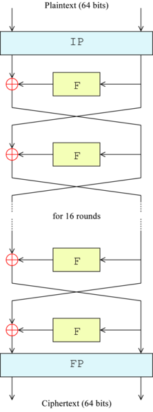
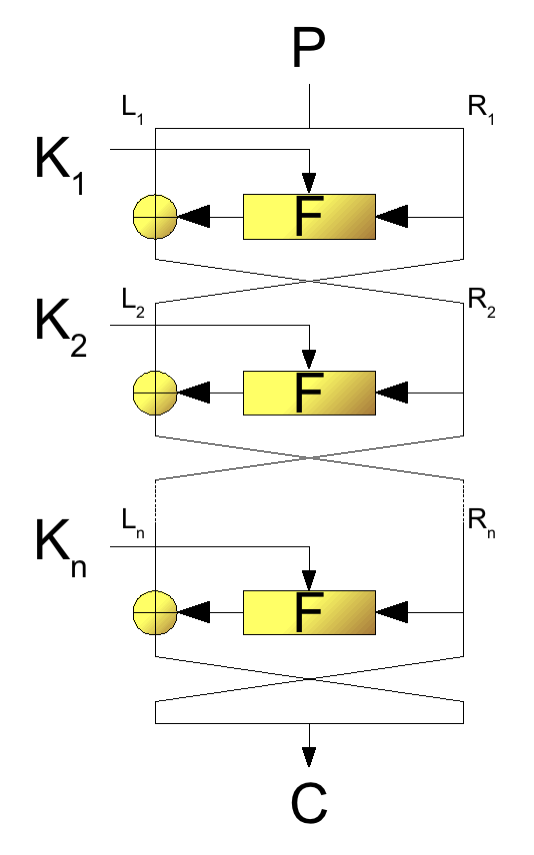
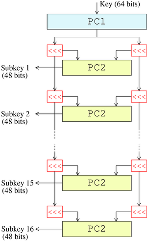

### Introduction
Encryption is something that has been done for a long time, even in the times of the Byzantines. This was done simply by either substituting characters for other characters or transposing them. This substitution/transposition table is called a cipher key, and this method is still used in modern day encryption. Only now multiple passes are applied and the tables used have become more and more complex.

DES is what is called a symmetric key algorithm. Meaning that the key can be used for both encrypting and decrypting. Or even better, even the same algorithm can be used! But more on that later. It was one of the most influential methods of modern cryptography in the academic world. Developed in the early 1970s at IBM and based on an earlier design by Horst Feistel, the algorithm was submitted to the National Bureau of Standards (NBS) following the agency's invitation to propose a candidate for the protection of sensitive, unclassified electronic government data.

### Algorithm
DES is based on using multiple passes (16 to be precise) over 64 bit blocks of the input. These block are separated into the left 32 bits and the right, applying the actual encryption on the left part with the use of the right. This means that with each pass more and more bits are involved with the outcome for each particular bit.

In the image below you can see that every pass, the Feistel function (F in the image) is applied on the right part and this result is combined with the left part with a exclusive-or operation (a bitwise operator where only one of the two input bits may be high for a high output) and the parts are swapped.

The key that you give is not the actual key that is used. The input key must be 64 bits and 56 bits will be selected by applying a permutation table (PC-1 in the images) with 8 parity bits (bits that are not used or used for error detecting). These bits are then divided into two halves: each is treated separately. In each round, both halves are rotated left by one or two bits (specified for each round in a table), and then 48 subkey bits are selected by applying another permutation table (PC-2). The rotations (denoted by "<<<" in the diagram) mean that a different set of bits is used in each subkey. Each bit is used in approximately 14 out of the 16 subkeys.

The key schedule for decryption is the same, only the subkeys are in reverse order compared to encryption. Apart from that change, the process is the same as for encryption. The same 28 bits are passed to all rotation boxes.

Schematic representation of the DES algorithm

Schematic representation of the Feistel function

Schematic representation of the key schedule
